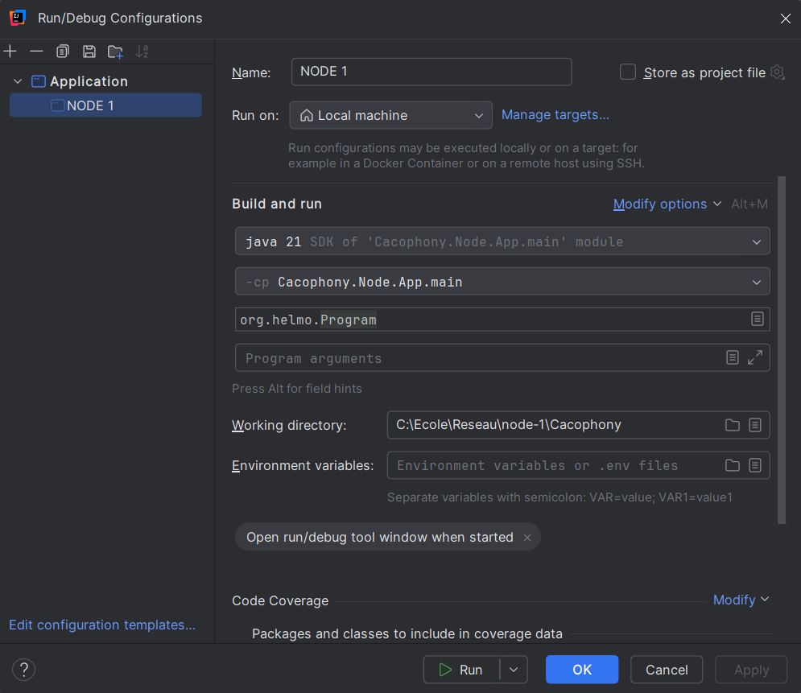
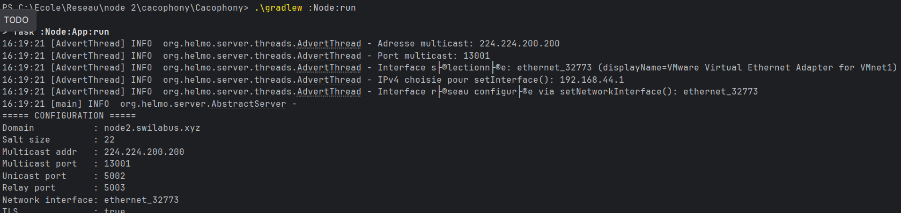
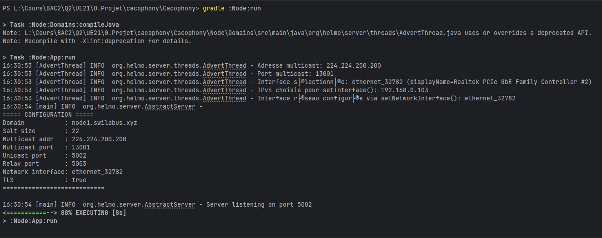

# Cacophony


      

## Badges

> Messagerie distribuée académique composée d'un Node Java, d'un Speaker Java et d'un client desktop Python.


## Points forts

- Architecture hybride Java + Python, séparée en composants clairs.
- Démarrage local rapide avec Gradle Wrapper (pas de Gradle global requis).
- Client GUI Python compatible TLS.
- Configuration simple via fichiers JSON.


## Présentation

Cacophony est un projet de messagerie distribuée organisé autour de trois composants :

- `Node` : coeur serveur en Java (multi-modules Gradle).
- `Speaker` : composant Java de diffusion/traitement.
- `cacophony-client` : client GUI Python pour se connecter au Node.

Le dépôt a été pensé pour un usage pédagogique, avec une structure lisible et des points d'entrée explicites pour lancer chaque composant.


### Statut du projet

Projet académique

### Auteurs

Contributeurs principaux (historique Git) :

- Thomas Derdeyn (GitLab : `t.derdeyn`)
- Clement Franchimont (GitLab : `cl.franchimont`)
- Tibo Maes (GitLab : `ti.maes`)
- Antoine Toussaint (GitLab : `an.toussaint`)

### Prérequis

- OpenJDK installé (pour les modules Java).
- Python 3.x et `pip` (pour le client).
- Windows PowerShell (commandes ci-dessous données pour Windows).


## Exécution locale

Ouvrez deux terminaux depuis la racine du projet.


### 1) Lancer le Node

```powershell
cd Cacophony
.\gradlew :Node:run

# Alternative si Gradle est installe globalement
gradle :Node:run
```

Configuration utilisee : `Cacophony/Node/config-node.json`


### 2) Lancer le Speaker

```powershell
cd Cacophony
.\gradlew :Speaker:run

# Alternative si Gradle est installe globalement
gradle :Speaker:run
```

Configuration utilisee : `Cacophony/Speaker/config-speaker.json`


## Captures d'écran de lancement

### Configuration de lancement



### Lancement avec `.\gradlew`



### Lancement avec `gradle`



## Exécuter les tests

Pour exécuter les tests Java :

```powershell
cd Cacophony
.\gradlew test
```

Commande utile supplémentaire (build) :

```powershell
cd Cacophony
.\gradlew build
```

## Structure du dépôt

- `Cacophony/` : code Java (Node, Speaker, Common)
- `logs/` : journaux générés à la racine du projet


## Configuration

Node :

- `Cacophony/Node/config-node.json`
- `Cacophony/Node/users.json`
- `Cacophony/Node/tags.json`

Speaker :

- `Cacophony/Speaker/config-speaker.json`
- `Cacophony/Speaker/domains.json`


## Journaux

Les journaux sont produits notamment dans :

- `Cacophony/Node/logs/`
- `Cacophony/Speaker/logs/`
- `logs/`


## Dépannage

- Si les modules Java ne démarrent pas, vérifiez que les commandes sont lancées depuis `Cacophony/`.
- En cas d'erreur réseau, vérifiez host/port/interfaces dans les JSON de configuration.
- En cas d'échec TLS côté client, vérifiez certificat et configuration TLS du Node.


## Ressources de cours

Les ressources suivantes sont fournies via la plateforme du cours ("disponible ici") :

- `InterfaceIdentifier.jar` : affiche le nom des interfaces reseau (Java 21 a modifie certains noms d'interfaces).
- `MulticastSpy21.jar` : affiche les echanges multicast.
- `cacophony-node.json` : exemple de configuration JSON pour le Node.
- `cacophony-speaker.json` : exemple de configuration JSON pour le Speaker.
- `star.swilabus.xyz.p12` : certificat TLS pour le client (mot de passe : `labo2026`).
- Certificats CA : `Swilabus Root CA RSA 2025` et `Swilabus Education CA RSA TLS 2025`.
- `MulticastForwarder.py` (projet fourni) : simulation des envois multicast via VPN.
- Fichier Excel d'inscription des membres du groupe.
- Video d'exemple de gestion de projet dans GitLab.

Important pour le multicast :

- Sélectionner l'interface réseau avant tout échange multicast (Node/Speaker/outils multicast).
- Vérifier que la valeur `networkInterface` dans les fichiers JSON correspond bien à l'interface active sur votre machine.


## Variables d'environnement

Ce projet n'utilise pas de fichier `.env` obligatoire dans sa forme actuelle.
La configuration est gérée via des fichiers JSON :

- `Cacophony/Node/config-node.json`
- `Cacophony/Speaker/config-speaker.json`
